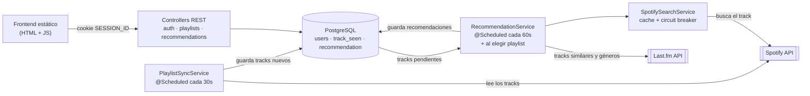

# Spotify Recommender

[](https://github.com/Gonzxxr/spotify-recommender/actions/workflows/ci.yml)

App web que analiza una playlist de Spotify y recomienda canciones nuevas usando la similitud de
Last.fm, sin repetir temas que ya están en la playlist.

Está pensada para **una sola instancia compartida por varias personas**: cada una conecta su propia
cuenta de Spotify (OAuth2 Authorization Code) y ve solo sus playlists y sus recomendaciones.

**Stack:** Java 21 · Spring Boot 4 · Spring Data JPA · PostgreSQL · OAuth2 hecho a mano · JUnit 5,
Mockito y Testcontainers · GitHub Actions · Docker.

## Arquitectura



La tabla `track_seen` funciona como una **cola productor/consumidor**: el job de sincronización la
llena y el de recomendaciones la consume. Los dos jobs no se conocen entre sí, y cada uno se ajusta
según lo que cuesta su API (Spotify para sincronizar, Last.fm más Spotify Search para recomendar).

## Cómo funciona

1. La persona entra a la app y toca "Conectar con Spotify" → login OAuth.
2. Elige una de sus playlists. Se sincronizan sus tracks y arranca una primera tanda de recomendaciones.
3. En segundo plano, un job mantiene la playlist sincronizada (solo vuelve a leer los tracks si cambió
   el `snapshot_id`) y otro genera recomendaciones: por cada track pide similares a Last.fm, descarta
   los de baja afinidad y los que ya están en la playlist o ya se recomendaron, y busca el resto en Spotify.
4. La UI muestra las recomendaciones de a tandas de 10, ordenadas por afinidad. Una recomendación ya
   mostrada no vuelve a aparecer hasta pasada una hora.

## Decisiones de diseño y lecciones aprendidas

Cosas que salieron mal (o casi) y cómo quedaron resueltas. Están en el historial de commits.

**Rate limiting de Spotify (el problema más difícil del proyecto).** Con una app en Development Mode,
la cuota de Spotify es chica y un solo error puede bloquear la búsqueda unas 20 horas. Cada punto de
entrada usa la estrategia que le corresponde:
- `PlaylistSyncService`: reintenta con backoff solo si el `Retry-After` es corto (≤ 5 s); si es largo,
  marca un `blockedUntil` y falla rápido, sin dormir el hilo.
- `SpotifySearchService`: llamadas serializadas y espaciadas (400 ms), circuit breaker global tras un
  429 y cache en memoria de aciertos y de "no encontrado" (nunca de errores transitorios).
- `RecommendationService`: evita el problema por diseño, con lotes acotados (20 tracks por tick, solo 5
  al elegir una playlist) y un cooldown de 6 h por track. La ruta "al elegir playlist" tiene un tope
  más bajo porque es la única que arranca sin nada en cache.

**Un solo hilo de `@Scheduled` puede congelar todo en silencio.** Spring ejecuta los jobs en un único
hilo por defecto, y los `RestClient` sin timeout pueden colgarse para siempre: un solo request trabado
frenaba sincronización y recomendaciones de todos los usuarios, sin error ni log. Ahora todos los
clientes tienen timeouts (5 s de conexión, 15 s de lectura), el pool del scheduler es de 2 hilos y
ningún job duerme según un valor que mande el servidor.

**Seguridad.**
- *CSRF en OAuth:* parámetro `state` aleatorio de un solo uso, con TTL de 10 minutos.
- *Sesión:* cookie `HttpOnly` y `SameSite=Lax` (y `Secure` en producción). El cliente nunca manda
  su propio `spotifyUserId`: un diseño anterior lo permitía y cualquier usuario podía actuar como otro
  (IDOR), así que la identidad sale siempre de la sesión en el servidor.
- *Tokens en reposo:* los tokens de Spotify se cifran en la base con AES-256-GCM (IV aleatorio por
  valor y tag de autenticación) mediante un `AttributeConverter` de JPA.

**Filtrado en la base, no en Java.** El primer `generateRecommendations` hacía `findAll()` y filtraba en
memoria con una consulta por fila. Ahora es una sola query con `NOT EXISTS` y paginación.

**Loguear los caminos que "no hacen nada".** Una ruta que retorna sin efecto ni log no deja pistas:
un bug de producción quedó 100 % en silencio hasta que se agregó logging a esos caminos.

**Los tests encontraron un bug real.** `LastFmClient` codificaba dos veces la URL, así que los
artistas con espacios se buscaban con un `%20` literal en el nombre. Lo detectó un test unitario con el
servidor HTTP simulado.

## Requisitos

- JDK 21
- Docker (para Postgres y para los tests de integración) o una instancia de Postgres propia
- Una app registrada en el [Spotify Developer Dashboard](https://developer.spotify.com/dashboard)
- Una API key de [Last.fm](https://www.last.fm/api/account/create)

## Configuración

La app no tiene ningún secreto hardcodeado: todo se toma de variables de entorno
(ver `src/main/resources/application.properties`).

| Variable | Descripción |
|---|---|
| `DB_PASSWORD` | Password de Postgres |
| `SPOTIFY_CLIENT_ID` | Client ID de tu app de Spotify |
| `SPOTIFY_CLIENT_SECRET` | Client Secret de tu app de Spotify |
| `SPOTIFY_REDIRECT_URI` | Debe coincidir EXACTO con el registrado en el dashboard de Spotify (default: `http://127.0.0.1:8080/auth/spotify/callback`) |
| `TOKEN_ENCRYPTION_KEY` | Clave AES-256 en base64 para cifrar los tokens de Spotify en la base. Generarla con `openssl rand -base64 32` |
| `LASTFM_API_KEY` | API key de Last.fm |
| `COOKIE_SECURE` | `true` cuando se sirve por HTTPS (default: `false`) |

En el dashboard de Spotify agregá tu `SPOTIFY_REDIRECT_URI` a la lista de Redirect URIs de la app.
Mientras la app esté en Development Mode, Spotify solo deja loguearse a los usuarios que agregues a mano
en el dashboard.

## Levantar el proyecto

```bash
docker compose up -d          # levanta Postgres

export DB_PASSWORD=...
export SPOTIFY_CLIENT_ID=...
export SPOTIFY_CLIENT_SECRET=...
export TOKEN_ENCRYPTION_KEY=...
export LASTFM_API_KEY=...

./mvnw spring-boot:run
```

La app queda en `http://127.0.0.1:8080`.

## Tests

```bash
./mvnw test      # unitarios, ~10s, sin Docker
./mvnw verify    # + integración y E2E (necesita Docker) + reporte de cobertura en target/site/jacoco/
```

- **Unitarios** (`*Test`): servicios, controllers (MockMvc standalone), entidades, DTOs y el conversor de cifrado.
  Spotify y Last.fm se simulan a nivel HTTP con `MockRestServiceServer`, así que el parseo y el manejo de
  errores son los de producción. Los TTL de sesión y de `state` OAuth se prueban con un `Clock` controlable.
- **Integración** (`*IT`): repositorios contra un Postgres real levantado con Testcontainers, y la app
  completa (controllers, servicios, JPA) con la red externa simulada.
- **E2E** (`e2e/UserJourneyIT`): servidor real en un puerto aleatorio y cliente HTTP real recorriendo
  login OAuth, elección de playlist, recomendaciones, jobs de fondo y logout.

Los jobs `@Scheduled` se apagan en tests con `app.scheduling.enabled=false` y se disparan a mano.
El CI corre `./mvnw verify` en cada push y PR, y comprueba que la imagen Docker siga construyendo.

## Deploy

El repo trae un `Dockerfile` multi-stage y toma la config de Postgres de `PGHOST`/`PGPORT`/`PGDATABASE`/
`PGUSER`/`PGPASSWORD` y el puerto de `PORT`, que es como la mayoría de las plataformas inyectan esos
valores. Sirve para cualquier lugar que corra contenedores y ofrezca un Postgres.

Como ejemplo, en [Railway](https://railway.app):

1. Crear un proyecto → "Deploy from GitHub repo" → elegir este repo (detecta el `Dockerfile`).
2. "+ New" → "Database" → "Add PostgreSQL": conecta solas las variables `PG*` al servicio de la app.
3. En "Variables" del servicio, agregar `SPOTIFY_CLIENT_ID`, `SPOTIFY_CLIENT_SECRET`, `TOKEN_ENCRYPTION_KEY`,
   `LASTFM_API_KEY`, `COOKIE_SECURE=true` (sin esto el navegador no manda la cookie de sesión por HTTPS) y
   `SPOTIFY_REDIRECT_URI=https://<tu-dominio>/auth/spotify/callback`.
4. Agregar esa misma URL a los Redirect URIs de la app en el dashboard de Spotify, y a cada persona que
   vaya a usarla como usuario de la app.

Fuera de `localhost` conviene servirla siempre detrás de HTTPS (proxy reverso tipo Caddy o nginx).

## Deuda técnica conocida / posibles mejoras

- Las sesiones (`SessionStore`) y el estado de OAuth (`OAuthStateStore`) viven en memoria: un
  reinicio del server desloguea a todos. Para un grupo chico no es un problema real, pero si se
  necesita persistencia entre reinicios habría que moverlas a la base o a Redis.
- `PlaylistSyncService.syncPlaylists()` recorre usuarios secuencialmente cada 30s; si el número
  de usuarios crece mucho, un ciclo podría tardar más de 30s y correrse (no es un bug, es un
  límite de diseño para grupos chicos).
- La cache de `SpotifySearchService` está en memoria y sin límite de tamaño ni expiración.
